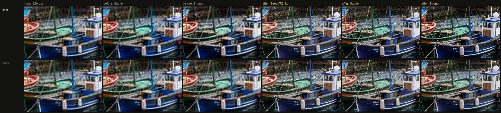

# QA report — Darkroom v2

Generated 2026-09-29 22:23 from the fixed-seed runs in `docs/qa/`
(`scripts/ab-phase1.ts`, `scripts/qa-phase6.ts`). Machine: RTX 3090 24 GB, ComfyUI 0.37.4. Golden set: `tests/golden/`
(synthetic, no real people, no Google Earth captures). Peak VRAM is whole-GPU usage sampled every 0.5 s, in decimal
GB (10⁹ bytes): the card's 24 GiB is 25.8 GB on this scale, so 25 GB means "nearly full", not "over capacity".

## Summary

Every v2 feature ran on the 10-image golden set with fixed seeds, on both image models where the feature has a model
choice. The first pass found **six real defects**, all fixed and re-run (DECISIONS 55–59):

| # | Defect found by QA | Fix |
|---|---|---|
| 1 | Smart select by text found only **one** match ("person" on a crowded street = one person) | SAM 3 `name:N` syntax via manifest `samMaxPerCategory` |
| 2 | A **single click** could return an empty mask | Lone click sent twice, so SAM returns its whole-object mask |
| 3 | Qwen3-VL text **cut off mid-word** at the token limit | Higher caps; unfinished sentence dropped |
| 4 | Klein-style captions **invented** a city and stacked two lenses | Prompt rule: no names unless written in the image; one lens mention |
| 5 | **Enhance on a small picture** gave a soft enlargement with JPEG blocks, even at Strong | SeedVR2 pre-upscale when the source is under half the working size |
| 6 | **Qwen-Image-Layered** returned noise layers when the picture had no caption | Always captioned (auto via Qwen3-VL) |

Rows re-run after a fix replace the failing ones in `runs.json`; the Enhance "before" rows are kept with the suffix
`-lanczos` so the difference is visible in the grid.

## Findings per feature

- **VLM (Qwen3-VL 8B):** captions are accurate on people, text and busy scenes; sign text ("SUNRISE BAKERY",
  "Fresh bread daily") is transcribed exactly. 2–5 s per request in this run, model load included. On the busy street it sometimes reads a partly hidden shop sign wrongly ("PAC", "Pacific Café") — small,
  distant text is the weakest case.
- **Prompt enhance:** keeps quoted text exactly ("Blue Hour") on both models; Klein output stays within 40–80 words,
  Qwen within 200.
- **SAM 3.1:** text, box and multi-click selections are clean; 1–7 s. One click may select a *part* (the laces of a
  boot) — that is SAM's normal behaviour, and the UI hint now says to click two or three spots.
- **Remove BG v2:** hair strands and cat fur survive on both edge models. On glass, **Lucida keeps real translucency**
  while BiRefNet makes the carafe opaque — Lucida is the better choice for glass and smoke; BiRefNet is slightly
  cleaner on solid objects. Naming the subject stops the matte from keeping the bench under the boots.
- **Layers:** SAM layers are fast (5–7 s) and exact but occluded areas stay empty (enable the background plate).
  Qwen-Image-Layered (about 115 s at 640 px) *does* fill the background behind removed objects, at lower resolution.
- **Instruct:** both models recolour the scarf without touching the face and rewrite "MOONLIGHT BAKERY" letter-perfect.
- **Outpaint:** both extend the street believably; Klein invents more (a new wooden door), Qwen continues more
  conservatively.
- **Enhance (clean 1 MP portrait):** Subtle is faithful on both; Klein pushes saturation slightly (the green scarf);
  Qwen is the more neutral of the two. **Strong** starts inventing content (Klein added a person at the frame edge
  of the low-res harbour) — use it for restoration of damaged pictures, not for faithful sharpening.
- **Enhance (320 px JPEG):** after the fix, SeedVR2 does the restoration and the diffusion pass adds texture; without
  it no strength setting removed the JPEG blocks.
- **Video:** Wan 2.2 (77 s) and LTX 2.5 (60 s) both honour start and end frames; the requested slow push-in is gentle
  on both.

## Recommended defaults (kept as shipped)

- Enhance denoise: Klein Subtle 0.3 / Strong 0.6; Qwen Subtle 0.35 / Strong 0.65 — Subtle for photos you want kept as
  they are, Strong for damaged or very soft sources.
- Remove BG edge model: BiRefNet by default; switch to Lucida for glass, smoke, veils and fine hair on busy backgrounds.
- Layers: SAM mode for exact object cut-outs at full resolution; Qwen mode when you need the background filled in.

## Incidents during testing

- **ComfyUI stall (Phase 1 A/B):** during a Wan render ComfyUI stopped answering HTTP for more than 8 minutes with
  VRAM full at 24 GB — the NVIDIA "system memory fallback" pattern. It was restarted from Comfy Desktop and the same
  job then ran in 83 s. Darkroom now waits through heavy steps without flipping to "offline" and shows a stall message
  after 3 minutes (DECISIONS 60).
- **LTX timing artefact:** the Phase 1 video A/B showed LTX 3–4× slower for the new prompts. It was the harness running
  back to back without `/free`; with `/free` (which the app always does before video) LTX is 48–50 s either way.
- **Shared GPU during QA:** one Qwen enhance case and the first stress round were contaminated by an extra test job on
  the same GPU; both were re-run on an idle GPU and only the clean numbers are reported.

## Remaining issues, ranked

1. **Qwen-Image-Layered is slow and low-resolution** (about 115 s, 640 px long edge, 24 GB peak). Its layers need an
   upscale for print use. Mitigation: use SAM layers + background plate for full-resolution work.
2. **Single-click selection is ambiguous** (part vs. whole object). Mitigated by the multi-click hint; a future option
   is to show SAM's three candidate masks and let the user pick, which needs a node that exposes them.
3. **Small, distant text** in captions is sometimes misread by Qwen3-VL 8B.
4. **Klein Strong enhance invents content** at frame edges; the Strong tooltip now says so; default stays Subtle.
5. **Video end frame equal to start frame** gives a gentle, almost static clip on both models — expected, but worth a
   hint in the UI when both slots hold the same picture.

## Phase 1 — old vs new prompts (A/B)

Grids (left: v1.0 prompt, right: new model-specific prompt, same seed):
- [styles-klein](qa/phase1/styles-klein.png)
- [styles-qwen](qa/phase1/styles-qwen.png)
- [edits-klein](qa/phase1/edits-klein.png)
- [edits-qwen](qa/phase1/edits-qwen.png)
- [video-wan](qa/phase1/video-wan.png)
- [video-ltx](qa/phase1/video-ltx.png)

| Group | Cases | Old median s | New median s |
|---|---|---|---|
| styles-klein | 15 | 8.4 | 8.4 |
| styles-qwen | 15 | 30.5 | 31.2 |
| edits-klein | 4 | 15.4 | 13.1 |
| edits-qwen | 4 | 27.6 | 27.6 |
| video-wan | 2 | 79.8 | 87.5 |
| video-ltx | 2 | 61.6 | 254.9 |

## Phase 6 — every feature on the golden set

| Feature | Cases | OK | Median time | Max peak VRAM | Grid |
|---|---|---|---|---|---|
| bg_v1_birefnet | 4 | 4 | 1.1 s | 2.5 GB | [view](qa/phase6/bg_v1_birefnet.jpg) |
| instruct_klein | 2 | 2 | 20.9 s | 21.4 GB | [view](qa/phase6/instruct_klein.jpg) |
| outpaint_klein | 1 | 1 | 20.2 s | 20.8 GB | [view](qa/phase6/outpaint_klein.jpg) |
| enhance_klein | 5 | 5 | 16.4 s | 21.0 GB | [view](qa/phase6/enhance_klein.jpg) |
| instruct_qwen | 2 | 2 | 33.3 s | 20.8 GB | [view](qa/phase6/instruct_qwen.jpg) |
| outpaint_qwen | 1 | 1 | 30.4 s | 20.8 GB | [view](qa/phase6/outpaint_qwen.jpg) |
| enhance_qwen | 5 | 5 | 27.1 s | 20.8 GB | [view](qa/phase6/enhance_qwen.jpg) |
| upscale | 1 | 1 | 8.5 s | 14.1 GB | [view](qa/phase6/upscale.jpg) |
| video_wan | 1 | 1 | 77.1 s | 23.7 GB | [view](qa/phase6/video_wan.jpg) |
| video_ltx | 1 | 1 | 60.4 s | 25.2 GB | [view](qa/phase6/video_ltx.jpg) |
| caption | 9 | 9 | 2.6 s | 11.1 GB | — |
| reverse | 6 | 6 | 3.3 s | 11.1 GB | — |
| enhance_prompt | 6 | 6 | 2.9 s | 10.9 GB | — |
| segment | 5 | 5 | 0.9 s | 14.0 GB | [view](qa/phase6/segment.jpg) |
| bg_v2_sam_birefnet | 4 | 4 | 24.4 s | 21.4 GB | [view](qa/phase6/bg_v2_sam_birefnet.jpg) |
| bg_v2_sam_lucida | 4 | 4 | 29.1 s | 20.8 GB | [view](qa/phase6/bg_v2_sam_lucida.jpg) |
| layers_sam | 2 | 2 | 7.4 s | 4.3 GB | [view](qa/phase6/layers_sam.jpg) |
| layers_qwen | 2 | 2 | 115.0 s | 25.3 GB | [view](qa/phase6/layers_qwen.jpg) |

**Enhance on a 320 px JPEG, zoomed to native resolution** (before and after the SeedVR2 pre-upscale fix, DECISIONS 55):

## VLM outputs (Qwen3-VL 8B)

Shown after `cleanVlmOutput`, exactly as the app displays them.

**caption / 01_portrait-short** (6.4s)

> An elderly woman with white hair smiles warmly while wearing a green knitted scarf near a window.

**caption / 01_portrait-detailed** (3.5s)

> An elderly woman with soft, silver-white hair smiles gently at the camera, her eyes crinkled with warmth and her cheeks marked by deep, natural lines. She wears a thick, textured green knitted scarf that drapes around her neck, its openwork pattern catching the light. The background is softly blurred, suggesting a window to her left, casting gentle, diffused daylight across her face. The color palette is muted, dominated by earthy tones and the vibrant green of her scarf. Shot in a close-up portrait, the shallow depth of field isolates her from the surroundings, emphasizing her serene expression and the intimate quality of the moment.
> The image is a photograph, capturing a candid yet composed moment with a naturalistic style.

**caption / 01_portrait-klein** (2.1s)

> An elderly woman with silver hair smiles warmly, her eyes crinkled with gentle joy, framed by a textured green knitted scarf. Shot in soft, natural window light with a shallow depth of field, the image captures intimate detail through a portrait lens, emphasizing skin texture and quiet contentment against a blurred background.

**reverse / 01_portrait-klein** (2.2s)

> An elderly woman with silver hair smiles warmly at the camera, her eyes crinkled with gentle joy. She wears a textured green knitted scarf. Soft natural light illuminates her face from the side, creating subtle shadows that highlight her skin’s texture. The background is softly blurred, suggesting a quiet indoor setting near a window.

**reverse / 01_portrait-qwen** (3.3s)

> An elderly woman with soft, silver-white hair framing her face, gazing gently toward the viewer with warm, knowing eyes. Her expression is serene and content, marked by gentle wrinkles around her eyes and mouth, revealing a subtle, genuine smile. She wears a textured, vibrant green knitted scarf wrapped loosely around her neck. The shot is a close-up portrait, framed tightly on her head and shoulders, with soft natural light illuminating her from the left side, creating a gentle glow. Background is softly blurred, suggesting an indoor setting near a window. Visual style: documentary photography style with fine details. Ultra HD, 4K, cinematic composition.

**caption / 03_text_scene-short** (1.7s)

> Sunrise Bakery displays fresh bread through its windows on a cobblestone street, inviting passersby with a chalkboard sign.

**caption / 03_text_scene-detailed** (3.9s)

> A quaint bakery named "SUNRISE BAKERY" occupies a corner building with weathered white walls and dark trim. Its large, multi-paned windows display golden loaves of bread, while an open door reveals warm interior lighting. A small chalkboard sign outside reads “Fresh bread daily.” The cobblestone street curves gently away, flanked by older buildings with varied facades. Soft, diffused daylight illuminates the scene from above, casting gentle shadows. The color palette is muted—whites, grays, browns, and deep blues—with accents of warm amber inside. Shot from eye level, the frame captures the bakery’s inviting entrance and the quiet street beyond, creating a sense of depth and charm.
> The image is a photograph with naturalistic detail and soft focus on distant elements, emphasizing the bakery’s rustic appeal.

**caption / 03_text_scene-klein** (2.6s)

> A charming corner bakery, “SUNRISE BAKERY,” invites with warm light spilling from its open door and windows displaying golden loaves; the scene rendered in rich, textured detail by a wide-angle lens under soft, diffused daylight, evoking a vintage film look. A chalkboard sign reads “Fresh bread daily” beside the dark wooden door, set against weathered stone walls along a cobbled street.

**reverse / 03_text_scene-klein** (2.5s)

> A charming corner bakery with a dark wooden door and ornate window frames, displaying golden loaves of fresh bread inside; the sign above reads "SUNRISE BAKERY" in elegant gold lettering on a black background. A chalkboard outside says "Fresh bread daily." Shot with a wide-angle lens under soft morning light, capturing cobblestone streets and weathered stone walls in a quiet, inviting atmosphere.

**reverse / 03_text_scene-qwen** (3.7s)

> A charming corner bakery with a black-painted facade and ornate white scrollwork framing its windows. The sign above reads "SUNRISE BAKERY" in elegant gold capital letters, positioned centrally across the top of the storefront. Two large, multi-paned windows display golden-brown loaves of fresh bread, while a dark blue door stands slightly ajar, revealing warm interior lighting. A small chalkboard sign leaning against the wall reads "Fresh bread daily" in neat cursive script. The building’s weathered stone walls contrast with the cobblestone street that curves gently away into the background, flanked by adjacent historic buildings. Shot from a low angle, capturing the inviting entrance and the textured street. Documentary photography style with fine details. Ultra HD, 4K, cinematic composition.

**caption / 04_busy_street-short** (1.7s)

> A bustling urban street teeming with pedestrians, vehicles, and trams navigating a crowded cityscape under bright daylight.

**caption / 04_busy_street-detailed** (3.7s)

> A bustling urban street teems with life, framed from an elevated perspective. A red tram glides down the center, flanked by yellow taxis and other vehicles, while cyclists navigate the rails. Pedestrians crowd sidewalks and spill into crosswalks, some under colorful awnings. Buildings line both sides, their facades weathered and layered with signs and balconies. Bright sunlight casts sharp shadows, illuminating the scene in warm tones of beige, gray, and vivid yellow. The camera’s high angle captures the full breadth of activity, emphasizing depth as the street recedes into a dense cityscape. Visible text includes “Pacific Coffee” on a storefront sign.
> The image is a photograph capturing the dynamic energy of daily urban life, with clear focus on the central roadway and surrounding crowds.

**caption / 04_busy_street-klein** (2.3s)

> A bustling urban street teems with life as pedestrians crowd sidewalks, cyclists glide between lanes, and yellow taxis weave past a red tram. Sunlight bathes the scene in warm, high-contrast tones, captured through a wide-angle lens. Buildings line both sides, their facades adorned with awnings and signs. A red banner reads "PAC" near center-right.

**reverse / 04_busy_street-klein** (2.5s)

> A bustling urban street teeming with pedestrians, cyclists, and vehicles including yellow taxis and a red tram, viewed from an elevated perspective. Sunlit concrete buildings line both sides, storefronts with awnings, and overhead wires crisscross the scene. A red vertical banner reads "PAC" in white letters near center-right. Shot through a window frame with natural daylight, capturing the vibrant energy of a dense city thoroughfare.

**reverse / 04_busy_street-qwen** (3.7s)

> A bustling urban street scene viewed from an elevated perspective, framed by window edges. The street is filled with pedestrians, cyclists, and vehicles including yellow taxis, a red tram, and cars. Buildings line both sides, featuring storefronts with awnings in orange and blue; some have visible signage. People are walking, standing, or cycling along sidewalks and roadways, creating dynamic movement. The asphalt road has embedded tram tracks running down the center. Bright daylight illuminates the scene, casting clear shadows. The composition captures depth with buildings receding into the background. Visual style: documentary photography style with fine details. Text visible: "Pacific Café" on a yellow sign, positioned right side, mid-ground, in bold red letters. Ultra HD, 4K, cinematic composition.

**enhance_prompt / idea1-klein** (2.1s)

> A towering stone lighthouse stands defiant against a howling storm, its beacon slicing through rain-slicked darkness with a warm, steady glow. Waves crash violently at its base, spray arcing in silver arcs under the low, diffused light of an overcast sky. Shot on a wide-angle lens with shallow depth of field, the scene feels immersive and cinematic, capturing the raw power of nature around the steadfast structure.

**enhance_prompt / idea1-qwen** (3s)

> A dramatic, cinematic lighthouse standing resiliently on a rugged cliffside during a violent storm, with crashing waves below and howling winds whipping rain into the air. The lighthouse is illuminated with a warm, steady beam cutting through the dark, turbulent sky filled with swirling gray clouds. Surrounding rocks are slick with spray, and distant sea foam crests violently against the shore. Shot from a low angle to emphasize its towering presence, with dynamic motion blur in the water and wind-blown grass at the base. Hyperrealistic photography style, high detail, volumetric lighting, and deep atmospheric perspective. The scene evokes raw nature’s power and the lighthouse as a steadfast beacon.

**enhance_prompt / idea2-klein** (1.7s)

> A vibrant poster for a Friday jazz night titled "Blue Hour," featuring a smoky, warmly lit stage with brass instruments gleaming under golden spotlights, framed by deep indigo curtains and a vintage neon sign glowing softly in the background, rendered in rich cinematic detail with shallow depth of field and warm ambient lighting.

**enhance_prompt / idea2-qwen** (3.6s)

> A vibrant, moody poster for a jazz night titled “Blue Hour” on Friday, rendered in a cinematic, noir-inspired realism style. The scene features a dimly lit jazz club at twilight, with warm amber lights glowing through smoky windows and soft shadows pooling across the floor. A lone saxophonist stands center stage, bathed in spotlight, while an audience sits in silhouette, immersed in the music. The title “Blue Hour” is prominently displayed in elegant, serif typography at the top, glowing slightly like neon against a deep indigo sky backdrop. Below, “Friday” appears in smaller, clean sans-serif font near the bottom right corner. The overall composition uses shallow depth of field, rich textures, and atmospheric haze to evoke intimacy and sophistication. Color palette: deep blues, burnt oranges, and charcoal grays. No extraneous elements — only the essence of live jazz under the enchanting blue hour.

**enhance_prompt / idea3-klein** (2s)

> A regal cat, its fur soft and sunlit, wears a miniature golden crown perched delicately on its head, catching the light like polished metal. Shot with a shallow depth-of-field lens, the scene is warm and intimate, set against a blurred wooden floor and dappled sunlight filtering through nearby curtains — the crown gleaming as if freshly minted, a quiet symbol of feline royalty.

**enhance_prompt / idea3-qwen** (2.9s)

> A whimsical, photorealistic portrait of a small domestic cat sitting regally on a soft velvet cushion, adorned with a delicate, miniature golden crown perched atop its head. The cat’s fur is fluffy and richly textured, with warm amber eyes gazing gently forward, exuding quiet nobility. Soft natural lighting illuminates the scene from the side, casting gentle shadows that enhance depth. The background is a blurred, elegant interior with muted pastel tones to emphasize the subject. The composition is centered, medium close-up shot, capturing the cat’s expressive face and the intricate details of the crown. No text or additional elements are present. Style: realistic photography with a touch of fantasy charm.

## Failures

None in the final runs.

## Swap-stress test (rapid switching between all model families)

25 of 25 jobs succeeded; max peak VRAM 25.4 GB.

| Step | Family | Time | Peak VRAM | OK |
|---|---|---|---|---|
| 0-klein | klein | 15.2 s | 20.5 GB | yes |
| 0-qwen | qwen | 20.1 s | 18.2 GB | yes |
| 0-vlm | vlm | 4.3 s | 11 GB | yes |
| 0-sam | sam | 3.2 s | 4 GB | yes |
| 0-edit | qwen | 27.1 s | 20.7 GB | yes |
| 0-upscale | seedvr2 | 7.5 s | 14.1 GB | yes |
| 0-layered | layered | 36.8 s | 24.8 GB | yes |
| 0-wan | wan | 38.2 s | 24.3 GB | yes |
| 0-ltx | ltx | 49.6 s | 25.3 GB | yes |
| 1-klein | klein | 15.8 s | 20.3 GB | yes |
| 1-qwen | qwen | 24.2 s | 17.9 GB | yes |
| 1-vlm | vlm | 4.7 s | 11 GB | yes |
| 1-sam | sam | 3.3 s | 3.9 GB | yes |
| 1-edit | qwen | 27.1 s | 20.7 GB | yes |
| 1-upscale | seedvr2 | 7.4 s | 14.2 GB | yes |
| 1-wan | wan | 38.2 s | 24.3 GB | yes |
| 1-ltx | ltx | 49.3 s | 25.4 GB | yes |
| 2-klein | klein | 15.8 s | 20.2 GB | yes |
| 2-qwen | qwen | 24.2 s | 17.9 GB | yes |
| 2-vlm | vlm | 4.7 s | 11 GB | yes |
| 2-sam | sam | 3.2 s | 4 GB | yes |
| 2-edit | qwen | 27 s | 20.5 GB | yes |
| 2-upscale | seedvr2 | 7.4 s | 14.2 GB | yes |
| 2-wan | wan | 38.1 s | 24 GB | yes |
| 2-ltx | ltx | 49.6 s | 25.3 GB | yes |
